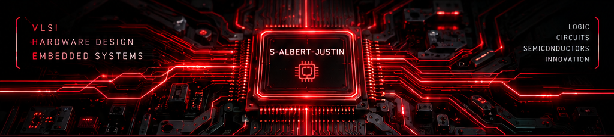

 
<!-- ================================================= -->
<!--                  CPU HEADER                       -->
<!-- ================================================= -->

<p align="center">
  
</p>

<h1 align="center">
  <span style="color:#FF2020">S. ALBERT JUSTIN</span>
</h1>

<h3 align="center">
  VLSI DESIGN | HARDWARE ENGINEERING | EMBEDDED SYSTEMS
</h3>

<p align="center">
  
</p>

<p align="center">
  
</p>

---

## `01` // ABOUT ME

```text
> Engineering Student
> Aspiring VLSI & Hardware Design Engineer
> Interested in Semiconductor Technology
```

I'm an engineering student fascinated by the intersection of electronics, hardware design, semiconductor technology, and software.

I enjoy understanding how things work at both logical and physical levels — from digital circuits and hardware description languages to 3D modelling and physical prototyping.

- ⚡ Knowledge of Verilog HDL and digital logic.
- 🔬 Interested in VLSI design and semiconductor fabrication.
- 🖥️ Experience with SolidWorks, AutoCAD and Fusion 360.
- 🛠️ Interested in 3D printing and hardware prototyping.
- 🐍 Programming with Python.
- 🔌 Exploring embedded systems and hardware integration.

<p align="center">
  <b>THINK IN LOGIC. DESIGN IN SILICON. BUILD BEYOND LIMITS.</b>
</p>

---

## `02` // ENGINEERING DOMAINS

<table>
<tr>
<td width="50%" valign="top">

### ⚡ VLSI & SEMICONDUCTORS

- Verilog HDL
- Digital Logic Design
- RTL Design
- Semiconductor Physics
- Integrated Circuits

</td>
<td width="50%" valign="top">

### 🔩 CAD & MECHANICAL DESIGN

- SolidWorks
- AutoCAD
- Fusion 360
- 3D Modelling
- 3D Printing

</td>
</tr>
<tr>
<td width="50%" valign="top">

### 🔌 EMBEDDED SYSTEMS

- Microcontrollers
- Sensors & Actuators
- ESP32
- Raspberry Pi
- Hardware Integration

</td>
<td width="50%" valign="top">

### 💻 PROGRAMMING

- Python
- C
- C++
- Automation
- Git & GitHub

</td>
</tr>
</table>

---

## `03` // TECH STACK

### HDL & Programming

<p>
  
  
</p>

### CAD & 3D Design

<p>
  
  
  
  
</p>

### Development & Embedded

<p>
  
</p>

---

## `04` // FEATURED PROJECTS

<p align="center">
  <a href="https://github.com/S-Albert-Justin/BioSync-r1">
    
  </a>
</p>

### 🫀 BioSync R1

A biomedical monitoring application combining mobile development with sensor-based hardware integration.

**Technologies:**
- Flutter & Dart
- ESP32
- MAX30102
- MPU6050

[](https://github.com/S-Albert-Justin/BioSync-r1)

---

## `05` // GITHUB STATISTICS

<p align="center">
  
  
</p>

<p align="center">
  
</p>

---

## `06` // CONTRIBUTION CALENDAR

<p align="center">
  
</p>

---

## `07` // CONNECT

<p align="center">
  <a href="https://github.com/S-Albert-Justin">
    
  </a>
</p>

<p align="center">
  <i>Learning. Experimenting. Engineering the future.</i>
</p>

<p align="center">
  
</p>
